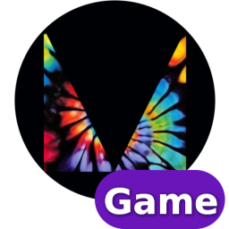
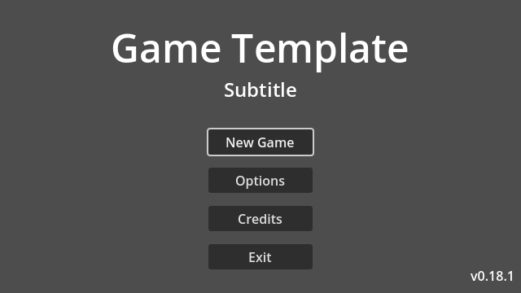
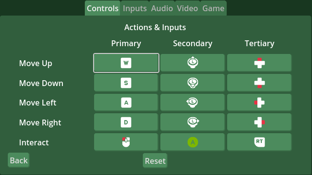
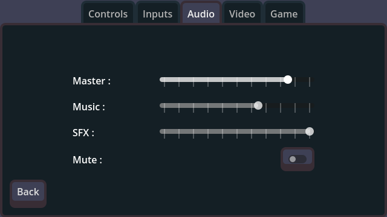
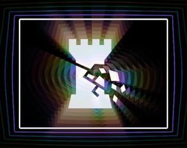
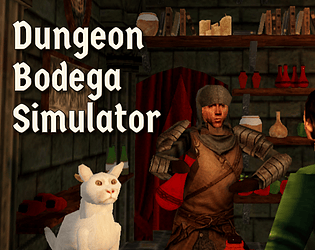
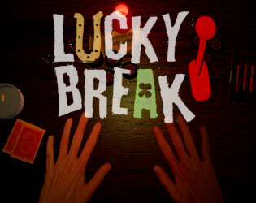

  

# Godot Game Template

  

This template has a main menu, options menus, pause menu, credits, scene loader, extra tools, and an example game scene.  

For *Godot 4.7* (4.4+ compatible)

[Example on itch.io](https://maaack.itch.io/godot-game-template)  

## Objective

Setup menus and accessibility features in about 15 minutes.

The template can be the start of a new project, or plug into an existing one. It is game agnostic (2D or 3D) and can work with multiple target resolutions, up to 4k and down to 640x360. It's meant to cover the needs for a typical game jam, while remaining scalable and extensible enough to support commercial games.

This template was originally made for Godot Wild Jam, and shares a no AI/LLM-gen policy. Please open an [issue](https://github.com/Maaack/Godot-Game-Template/issues) if there is a violation.  

## Choosing A Plugin

| Features | Game Template  ([link](https://github.com/Maaack/Godot-Game-Template)) | Minimal Game Template  ([link](https://github.com/Maaack/Godot-Minimal-Game-Template)) | Menus Template ([link](https://github.com/Maaack/Godot-Menus-Template)) |
| :-------:  | :-------: | :-------: | :-------: |
| Main Menu | :green_circle: | :green_circle: | :green_circle: |
| Options Menus | :green_circle: | :green_circle: | :green_circle: |
| Credits Scene | :green_circle: | :large_blue_diamond: | :green_circle: |
| Game Scene | :green_circle: | :large_blue_diamond: | :x: |
| Level Manager | :green_circle: | :green_circle: | :x: |
| Game & Level State | :green_circle: | :x: | :x: |
| Scene Loader | :green_circle: | :purple_square: | :green_circle: |
| Music Controller | :green_circle: | :purple_square: | :green_circle: |
| UI Sound Controller | :green_circle: | :purple_square: | :green_circle: |

**Key: :green_circle: Included, :large_blue_diamond: Simplified, :purple_square: Available Separately, :x: Not Available**  

More options are available from the [plugin suite](/docs/PluginSuite.md).  

## Installation

*Maaack's Game Template* is available in both the *Godot Asset Library* and the *Godot Asset Store*. It is available as both a template and a plugin, meaning it can be used to start a new project, or added to an existing project.

### New Project
While in the *Godot Project Manager*:

1.  Go to the **Asset Store** tab.
2.  Search for "Maaack's Game Template".
3.  Click on the result to open the template details.
4.  Click to **Download**.
5.  Give the project a new name and destination.
6.  Click to **Install & Edit**.
7.  Continue with the [Basic Setup](/docs/BasicSetup.md).

### Existing Project
While editing a project in *Godot*:

1.  Go to the **Asset Store** tab.
2.  Search for "Maaack's Game Template Addon".
3.  Click on the result to open the plugin details.
4.  Click to **Download**.
5.  Check that contents are getting installed to `addons/` and if there are any conflicts.  
Conflicts that are safe to ignore:
    -  `addons/plugin_updater/`
    -  `addons/clean_copy_examples/`
    -  `addons/maaacks_scene_loader/`
    -  `addons/maaacks_music_controller/`
    -  `addons/maaacks_ui_sound_controller/`
6.  Click to **Install**.
7.  Reload the project (you may see errors before you do this).
8.  Enable the plugin(s) from the **Project > Project Settings > Plugins** tab.  
    1.  Optionally, enable the following:
        -  *Plugin Updater*
        -  *Maaack's Scene Loader*
        -  *Maaack's Music Controller*
        -  *Maaack's UI Sound Controller*
    2.  Enable *Maaack's Game Template*.
    3.  If it's enabled for the first time, the setup wizard will start.  
        Close the window behind it and complete the setup wizard.  
9.  Continue with the [Basic Setup](/docs/BasicSetup.md).

## Usage

[Basic Setup](/docs/BasicSetup.md) is done through the setup wizard at **Project > Tools > Run Maaack's Game Template Setup...**.  

As part of setup, example scenes are copied out of `/addons/` into a desired folder (project root by default). These can be edited to fit requirements.

### More Documentation

[Feature List](/docs/FeatureList.md)  
[Main Menu Setup](/docs/MainMenuSetup.md)  
[Options Menu Setup](/docs/OptionsMenuSetup.md)  
[Game Scene Setup](/docs/GameSceneSetup.md)  
[Updating Credits](/docs/UpdatingCredits.md)  
[Blending Music](/addons/maaacks_music_controller/docs/BlendingMusic.md)  
[Adding UI Sound Effects](/addons/maaacks_ui_sound_controller/docs/AddingUISFX.md)  
[Loading Scenes](/addons/maaacks_scene_loader/docs/LoadingScenes.md)  
[Input Remapping Menus](/docs/InputRemappingMenus.md)  
[Input Icon Mapping](/docs/InputIconMapping.md)  
[Joypad Inputs](/docs/JoypadInputs.md)  
[Game Saving](/docs/GameSaving.md)  
[How Parts Work](/docs/HowPartsWork.md)  
[Moving Files](/docs/MovingFiles.md)  
[Uploading to itch.io](/docs/UploadingToItchIo.md)  
[Build and Publish Your Game Using CICD](/docs/BuildAndPublish.md)  
[Automatic Updating](/docs/AutomaticUpdating.md)  
[Exhibiting Your Game](/docs/Exhibiting.md)  

## Media

### Videos

  
[More Videos](/docs/Videos.md)

### Screenshots

  
  
  
[More Screenshots](/docs/Screenshots.md)  

## Featured Games

| Crumbling Castle | Dungeon Bodega Simulator | Lucky Break |  
| :-------:| :-------: | :-------: |
|  |  |  |
| [Play on itch.io](https://maaack.itch.io/crumbling-castle) |  [Play on Steam](https://store.steampowered.com/app/3458180/Dungeon_Bodega_Simulator/)  | [Play on Steam](https://store.steampowered.com/app/4155880/Lucky_Break/)  |

[All Shared Games](/docs/GamesMade.md)  

## Community

Join the [Discord server](https://discord.gg/AyZrJh5AMp) and share your work with others. It's also a space for getting or giving feedback, and asking for help. 

## Links
[Attribution](/addons/maaacks_game_template/ATTRIBUTION.md)  
[License](/addons/maaacks_game_template/LICENSE.txt)  
[Godot Asset Store - Template](https://store.godotengine.org/asset/maaack/maaacks-game-template/)  
[Godot Asset Store - Addon](https://store.godotengine.org/asset/maaack/maaacks-game-template-addon/)  
[Godot Asset Library - Template](https://godotengine.org/asset-library/asset/2703)  
[Godot Asset Library - Plugin](https://godotengine.org/asset-library/asset/2709)  
