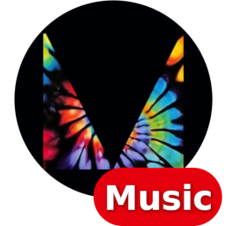
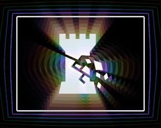
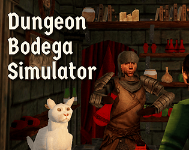
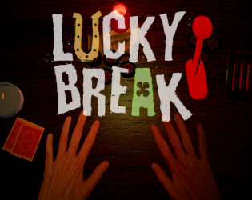

  

# Godot Music Controller

  

This music controller keeps music playing between scenes and blends tracks.

For *Godot 4.7* (4.3+ compatible)

[Example on itch.io](https://maaack.itch.io/godot-game-template) of *[Maaack's Game Template](https://github.com/Maaack/Godot-Game-Template)*, which includes additional features.

## Objective

Setup blending between audio stream players in your scenes within 5 minutes.

This plugin was originally made for Godot Wild Jam, and shares a no AI/LLM-gen policy. Please open an [issue](https://github.com/Maaack/Godot-Music-Controller/issues) if there is a violation.  

### Extras or Components

Users that want additional features can try *[Maaack's Game Template](https://github.com/Maaack/Godot-Game-Template)* or other options from the [plugin suite](/docs/PluginSuite.md).  

## Installation

*Maaack's Music Controller* is available in both the *Godot Asset Library* and the *Godot Asset Store*. It is available as a plugin, meaning it can be added to an existing project.

### Existing Project
While editing a project in *Godot*:

1.  Go to the **Asset Store** tab.
2.  Search for "Maaack's Music Controller".
3.  Click on the result to open the plugin details.
4.  Click to **Download**.
5.  Check that contents are getting installed to `addons/` and there are no conflicts.
6.  Click to **Install**.
7.  Reload the project (you may see errors before you do this).
8.  Enable the plugin from the **Project > Project Settings > Plugins** tab.

## Usage
Open up the `music_controller.tscn` autoload scene and adjust the *Fade In/Out Duration*.  

Refer to [Blending Music](/docs/BlendingMusic.md) for more details.

### More Documentation

[Automatic Updating](/docs/AutomaticUpdating.md)  

## Featured

| Crumbling Castle | Dungeon Bodega Simulator | Lucky Break |  
| :-------:| :-------: | :-------: |
|  |  |  |
| [Play on itch.io](https://maaack.itch.io/crumbling-castle) |  [Play on Steam](https://store.steampowered.com/app/3458180/Dungeon_Bodega_Simulator/)  | [Play on Steam](https://store.steampowered.com/app/4155880/Lucky_Break/)  |

[All Shared Games](/docs/GamesMade.md)  

## Community

Join the [Discord server](https://discord.gg/AyZrJh5AMp) and share your work with others. It's also a space for getting or giving feedback, and asking for help. 

## Links
[Attribution](/addons/maaacks_music_controller/ATTRIBUTION.md)  
[License](/addons/maaacks_music_controller/LICENSE.txt)  
[Godot Asset Store](https://store.godotengine.org/asset/maaack/maaacks-music-controller/)  
[Godot Asset Library](https://godotengine.org/asset-library/asset/2898)  
