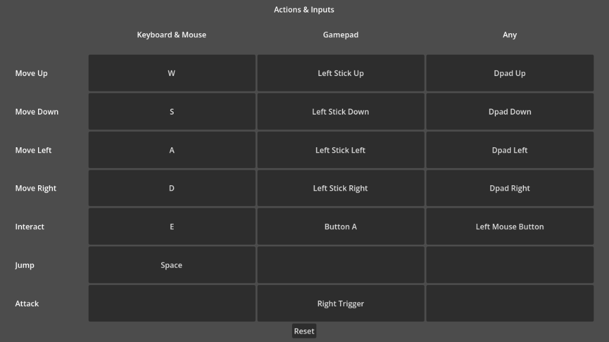
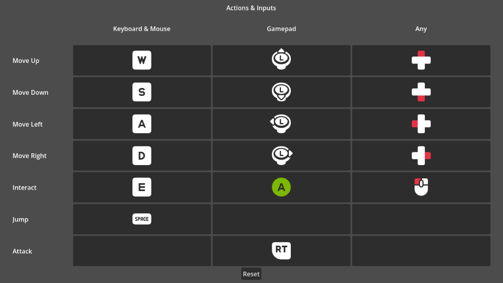
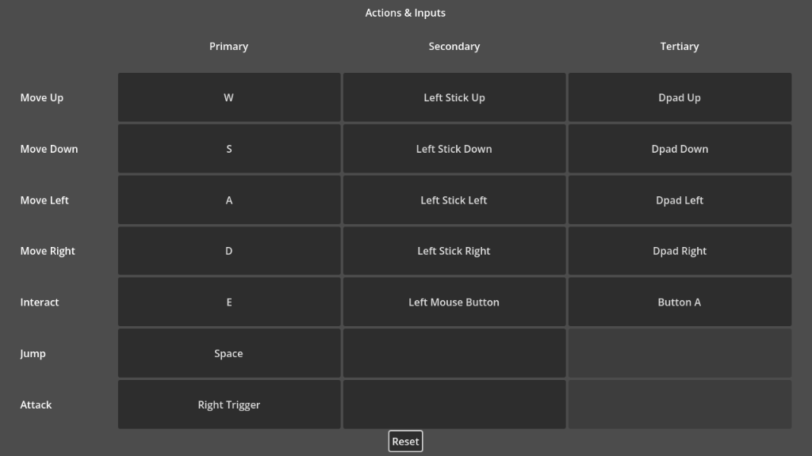
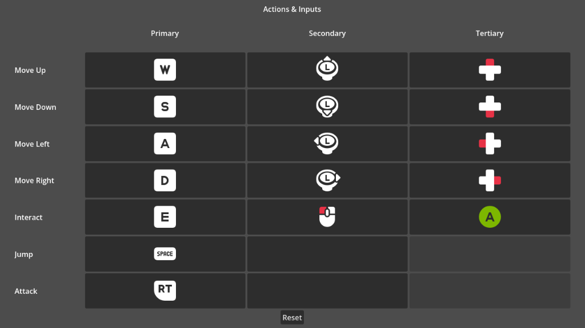
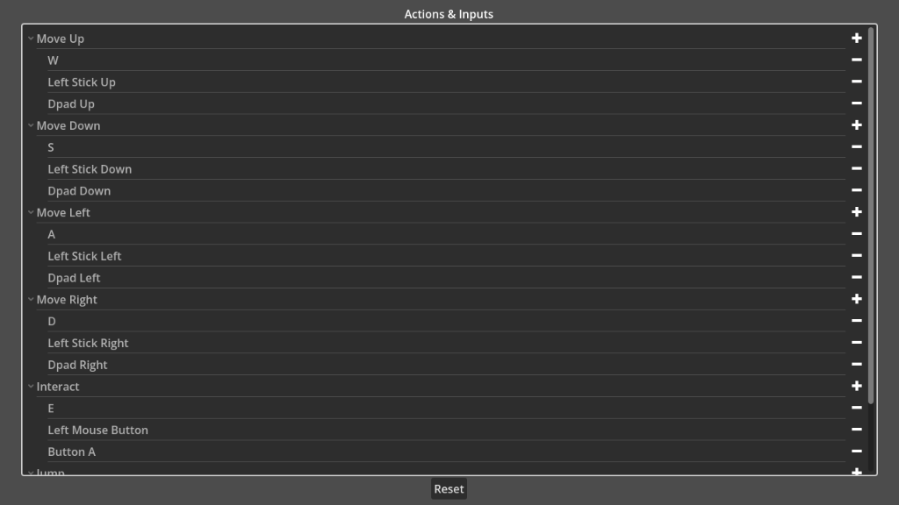
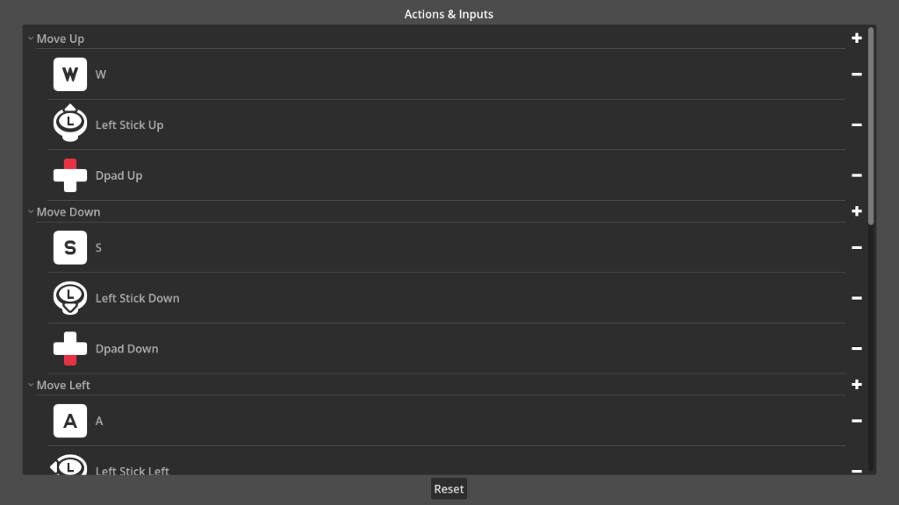

# Game Template Menus

The `input_options_menu.tscn` is a menu controller that can switch between different remapping menus provided with the addon/template. The actions and inputs are automatically populated from the **Project > Project Settings > Input Map**.

The current menu options are:

* `Device Table` (Default)
* `Table`
* `Tree`

To change to a different input remapping menu, open `input_options_menu.tscn`, select the `Control` node in the *SceneTree*, and then change the `Remapping Mode` in the *Inspector*.

## Device Table

The `Device Table` remapping menu is similar to the `Table`, but it allows the player to remap inputs by specific input devices. To adjust the type of devices that can be edited, select the `InputActionsDeviceTable` in the *SceneTree*, and then change the `Action Group Input Devices` in the *Inspector*.

## Table

The `Table` remapping menu allows the player to remap an adjustable number of inputs per action, regardless of the input device. To adjust the number of editable inputs per action, select the `InputActionsTable` in the *SceneTree*, and then adjust the `Action Groups` in the *Inspector*.

## Tree

The `Tree` remapping menu allows the player to remap any number of inputs per action, regardless of the input device. It most closely resembles the Godot editor's input map.

## Next Steps

### Recommended
1.  [Adding Icons to the Input Options](/docs/InputIconMapping.md)  
2.  [Supporting Joypad Inputs](/docs/JoypadInputs.md)  
